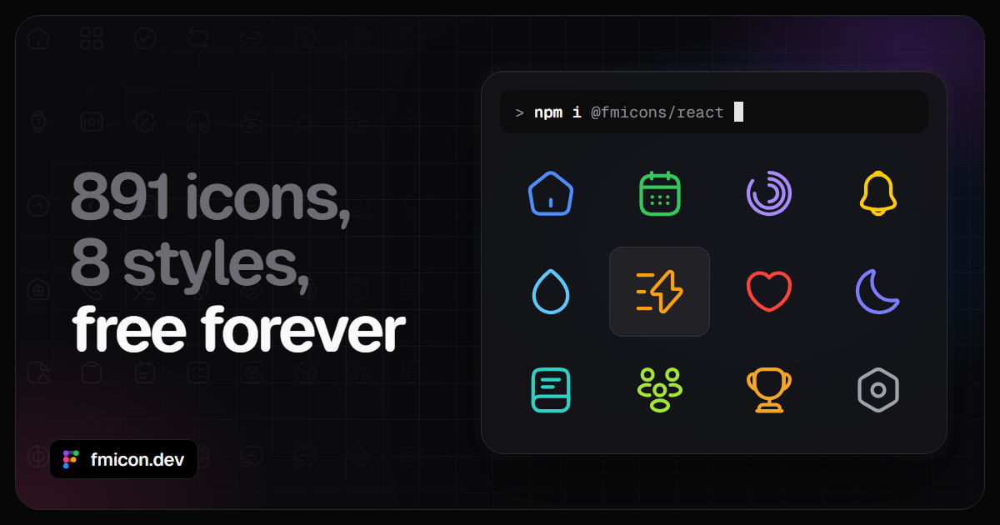
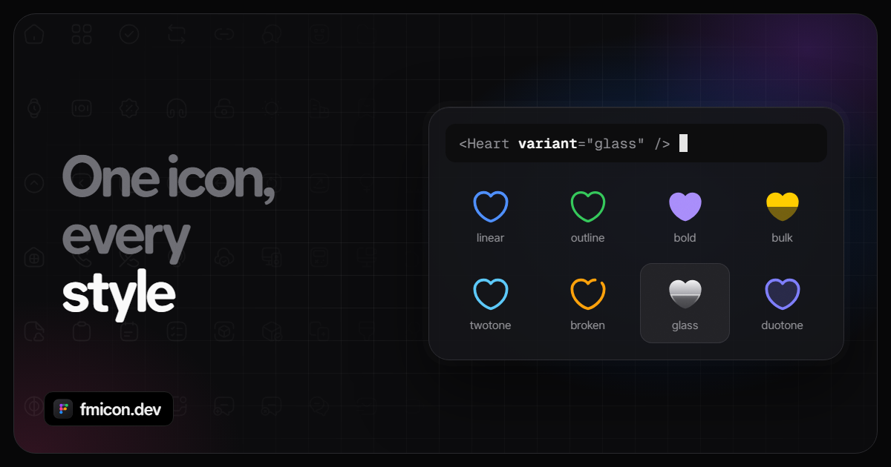

<div align="center">

<a href="https://fmicon.dev">
  <picture>
    <source media="(prefers-color-scheme: dark)" srcset=".github/assets/wordmark-dark.png">
    
  </picture>
</a>

### Open-source icon library for designers and developers

**891 UI icons in 8 styles**: free and open source for every framework you build with.

<p>
  <a href="https://fmicon.dev"></a>
  <a href="https://fmicon.dev/docs"></a>
  <a href="https://fmicon.dev/icons"></a>
  <a href="https://fmicon.dev/icons"></a>
  <a href="LICENSE"></a>
  <a href="https://github.com/Kakahaja07/fmicons/stargazers"></a>
</p>

<a href="https://fmicon.dev/icons"></a>

</div>

<br>

## Packages

<div align="center">

<table>
  <thead>
    <tr><th>Logo</th><th>Package</th><th>Version</th><th>Install</th><th>Links</th></tr>
  </thead>
  <tbody>
    <tr>
      <td align="center"></td>
      <td><code>@fmicons/react</code></td>
      <td></td>
      <td><code>npm i @fmicons/react</code></td>
      <td><a href="https://fmicon.dev/docs/react">Docs</a> · <a href="packages/react">Source</a></td>
    </tr>
    <tr>
      <td align="center"></td>
      <td><code>@fmicons/vue</code></td>
      <td></td>
      <td><code>npm i @fmicons/vue</code></td>
      <td><a href="https://fmicon.dev/docs/vue">Docs</a> · <a href="packages/vue">Source</a></td>
    </tr>
    <tr>
      <td align="center"></td>
      <td><code>@fmicons/svelte</code></td>
      <td></td>
      <td><code>npm i @fmicons/svelte</code></td>
      <td><a href="https://fmicon.dev/docs/svelte">Docs</a> · <a href="packages/svelte">Source</a></td>
    </tr>
    <tr>
      <td align="center"></td>
      <td><code>@fmicons/react-native</code></td>
      <td></td>
      <td><code>npm i @fmicons/react-native</code></td>
      <td><a href="https://fmicon.dev/docs/react-native">Docs</a> · <a href="packages/react-native">Source</a></td>
    </tr>
    <tr>
      <td align="center"></td>
      <td><code>@fmicons/core</code></td>
      <td></td>
      <td><code>npm i @fmicons/core</code></td>
      <td><a href="https://fmicon.dev/docs/vanilla">Docs</a> · <a href="packages/core">Source</a></td>
    </tr>
    <tr>
      <td align="center"></td>
      <td><code>@fmicons/svg</code></td>
      <td></td>
      <td><code>npm i @fmicons/svg</code></td>
      <td><a href="https://fmicon.dev/docs/svg">Docs</a> · <a href="packages/svg/icons">Browse</a></td>
    </tr>
    <tr>
      <td align="center"></td>
      <td>Angular</td>
      <td colspan="2">Copy a ready standalone component from any icon page</td>
      <td><a href="https://fmicon.dev/docs/angular">Docs</a></td>
    </tr>
    <tr>
      <td align="center"></td>
      <td>Flutter</td>
      <td colspan="2">Copy a <code>SvgPicture</code> snippet from any icon page</td>
      <td><a href="https://fmicon.dev/docs/flutter">Docs</a></td>
    </tr>
  </tbody>
</table>

</div>

Every icon is its own module, so bundlers keep only the icons you import. All packages ship TypeScript types.

## Quick start

```jsx
import { Home, Lock, Heart } from "@fmicons/react";

export default function Toolbar() {
  return (
    <nav>
      <Home size={24} />
      <Lock size={24} variant="bold" />
      <Heart size={24} variant="duotone" color="#ff383c" />
    </nav>
  );
}
```

<details>
<summary><b>Vue</b></summary>

```vue
<script setup>
import { Lock } from "@fmicons/vue";
</script>

<template>
  <Lock :size="24" variant="bold" />
</template>
```

</details>

<details>
<summary><b>Svelte</b></summary>

```svelte
<script>
  import { Icon } from "@fmicons/svelte";
  import { lock } from "@fmicons/core";
</script>

<Icon icon={lock} size={24} variant="bold" />
```

</details>

<details>
<summary><b>React Native</b></summary>

```jsx
import { Lock } from "@fmicons/react-native";

<Lock size={24} variant="bold" color="#1265ec" />
```

</details>

<details>
<summary><b>Vanilla JS</b></summary>

```js
import { lock, toSvg } from "@fmicons/core";

el.innerHTML = toSvg(lock, { size: 24, variant: "bold" });
```

</details>

<details>
<summary><b>CDN (no install)</b></summary>

Swap the style folder and the slug for the icon you want:

```html

```

An SVG loaded through `` can't take your text colour, so it draws in black. Use a package, or inline the SVG, to recolour it.

</details>

## 8 styles, one shape

<div align="center">
<a href="https://fmicon.dev/icons"></a>
</div>

<br>

| Style | Look | Best for |
|---|---|---|
| [`linear`](https://fmicon.dev/icons) | One even stroke, no fills | Toolbars, tab bars, anything beside text |
| [`outline`](https://fmicon.dev/icons/outline) | Linear shapes as filled contours | Design files and print |
| [`bold`](https://fmicon.dev/icons/bold) | Solid filled shapes | Active and selected states |
| [`bulk`](https://fmicon.dev/icons/bulk) | Solid over a soft second layer | Feature lists, empty states |
| [`twotone`](https://fmicon.dev/icons/twotone) | Main lines strong, details softer | Dashboards, onboarding |
| [`broken`](https://fmicon.dev/icons/broken) | Strokes with small gaps | Playful brands, landing pages |
| [`glass`](https://fmicon.dev/icons/glass) | Frosted 3D look, own colours (`glass-light` for light grounds) | App tiles, hero sections |
| [`duotone`](https://fmicon.dev/icons/duotone) | Line over a tinted fill | A hint of colour in product UI |

## Props

| Prop | Type | Default | Description |
|---|---|---|---|
| `size` | `number \| string` | `24` | Width and height in pixels |
| `variant` | `"linear" \| "outline" \| "bold" \| …` | `"linear"` | Any of the 8 styles, plus `"glass-light"` |
| `color` | `string` | `currentColor` | Any CSS colour; glass keeps its own |
| `strokeWidth` | `number \| string` | `1.5` | Line weight for linear, twotone, broken and duotone |
| `title` | `string` | | Accessible name; without it the icon is hidden from screen readers |

Component names are the PascalCase of the icon's slug (`arrow-circle-right` is `ArrowCircleRight`). Each is also exported with an `Icon` suffix (`MapIcon`) for when a name clashes with a global. Find any icon's name at [fmicon.dev/icons](https://fmicon.dev/icons).

## Contributing

Issues and pull requests are welcome. To report a problem with an icon, name its slug and style. To request a new icon, [open an issue](https://github.com/Kakahaja07/fmicons/issues/new). For code changes, run `npm run packages` and check the output before you open a pull request.

## Licence

The code is [MIT licensed](LICENSE). The base icon shapes come from the "7000 FREE UI ICONS" Figma Community file by Cristian Muñoz and are redistributed with attribution; the glass and duotone styles are derived from it in this project. Keep the notice in [LICENSE](LICENSE) when you redistribute the icons.

<div align="center">
<br>
Made by Prashant Sharma, who loves icons. If FM Icons saves you time, a ⭐ helps others find it.
</div>

---

<details>
<summary><b>Working on the website and packages</b></summary>

<br>

The site at [fmicon.dev](https://fmicon.dev) lives in this repository too: TanStack Start, React and CSS Modules, prerendered to static HTML at build time.

```sh
npm install
npm run dev          # http://localhost:3000
npm run build        # static site in dist/client
npm run packages     # rebuild the npm packages in packages/
npm run articles     # rebuild the icon page articles from scripts/data/
npm run social       # rebuild the share images in public/og/
npm run cdn:build    # SVG and PNG files for cdn.fmicon.dev in dist-cdn/
npm run cdn:upload   # upload dist-cdn/ to Cloudflare R2 (needs R2 keys, see the script)
npm run icons        # regenerate the site's UI icons from the FMUI 7000 library
npm run free-icons   # rebuild src/content/free-icons from the source artwork
```

`npm run icons` and `npm run free-icons` read the original artwork from a local folder (see the paths at the top of each script), so most contributors only need `dev`, `build` and `packages`.

**Building the packages.** `npm run packages` writes the SVG files to `packages/svg/icons/` (committed; they serve the CDN), the JavaScript and typings to `packages/<name>/dist/` (git-ignored), and each package's `package.json` and `README.md`. Hand-written runtime code lives in `packages/<name>/runtime/`. Change package metadata in `scripts/build-packages.mjs`, not in the generated files.

| You want to change… | Edit |
|---|---|
| Colours, fonts, radii, shadows, motion | `src/styles/tokens.css` |
| Any text, link or FAQ | `src/content/site.ts` |
| Docs pages | `src/content/docs.ts` |
| Icon page and library page articles | `scripts/data/`, `src/content/iconArticle.ts`, `src/content/libraryArticle.ts` |
| Icons used in the site's own UI | `scripts/sync-icons.mjs`, then `npm run icons` |
| Packages | `scripts/build-packages.mjs` and `packages/<name>/runtime/`, then `npm run packages` |

```
src/
  routes/       __root.tsx · _site.tsx (header and footer) · _site.index.tsx (home) · _site.docs.*.tsx (docs)
                icons.index.tsx · icons.$style.index.tsx · icons.$style.$slug.tsx (icon browser and icon pages)
  content/      site.ts · docs.ts · iconArticle.ts · libraryArticle.ts · freeIcons.meta.ts (generated)
                free-icons/ (icon data per style, generated) · icon-articles/ (generated)
  styles/       tokens.css · global.css
  components/   ui/ (Button, Tabs, CodeBlock, Wordmark…) · sections/ · docs/ · art/ · icons/ (generated)
  hooks/ lib/
packages/       the npm packages
scripts/        generators for icons, packages, articles, share images and the CDN
```

</details>
