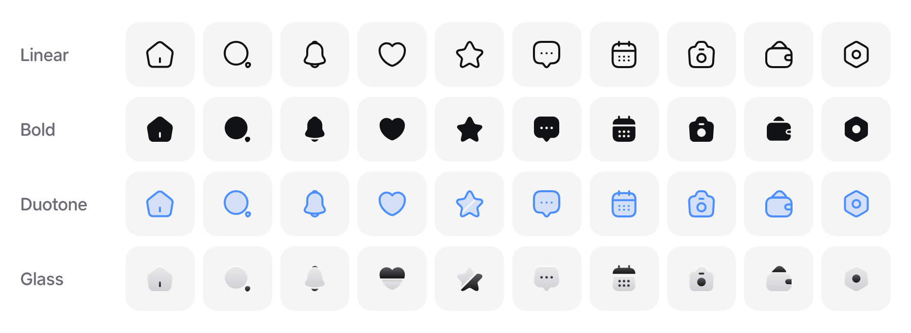

<div align="center">

<a href="https://fmicon.dev"></a>

### Every fmicon icon as a plain SVG file

<a href="https://www.npmjs.com/package/fmicon-svg"></a>
<a href="https://www.npmjs.com/package/fmicon-svg"></a>
<a href="https://github.com/Kakahaja07/fmicon/blob/main/LICENSE"></a>

**[Website](https://fmicon.dev)** · **[Browse icons](https://fmicon.dev/icons)** · **[Docs](https://fmicon.dev/docs/svg)** · **[GitHub](https://github.com/Kakahaja07/fmicon)**



</div>

fmicon is a free, open-source set of 1021 icons, each drawn in 9 styles. Use them in personal and commercial projects. No sign-up, and no credit needed in your app.

1021 icons as plain SVG files, one folder per style. Every file is a 24 by 24 SVG that uses `currentColor` (glass and color carry their own colours).

## Install

```sh
npm install fmicon-svg
```

## Usage

Files live at `fmicon-svg/icons/<style>/<slug>.svg`.

```js
// With a bundler that imports SVG files as URLs (Vite, webpack asset modules)
import lockUrl from "fmicon-svg/icons/linear/lock.svg";
```

From the CDN, with no install:

```html

```

`icons.json` lists every icon with its `slug`, `name` and `category`.

## Variants

`linear`, `outline`, `bold`, `bulk`, `twotone`, `broken`, `glass`, `glass-light`, `duotone`, `color`. The default is `linear`.

- `linear`, `twotone`, `broken` and `duotone` are line styles (stroke width 1.5).
- `glass` is tuned for dark backgrounds and `glass-light` for light ones. Both carry their own colours.
- `color` icons are bright and layered, with their own hues. Their parts carry the classes `fmi-body`, `fmi-accent` and `fmi-detail`, so you can animate them with CSS (the snippet is in the fmicon README on GitHub).

## Links

- Browse all 1021 icons: https://fmicon.dev/icons
- Source and issues: https://github.com/Kakahaja07/fmicon
- Licence: MIT for the code. The icon artwork comes with an attribution notice, see [LICENSE](https://github.com/Kakahaja07/fmicon/blob/main/LICENSE).
